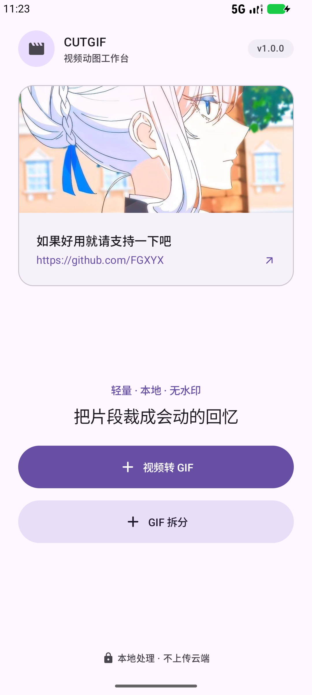
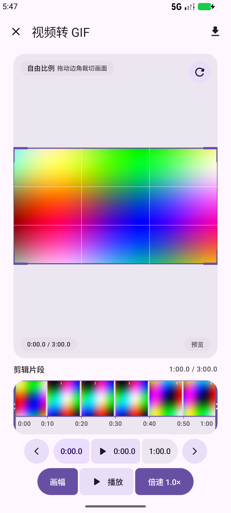
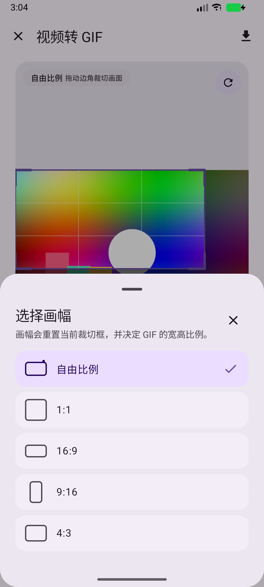
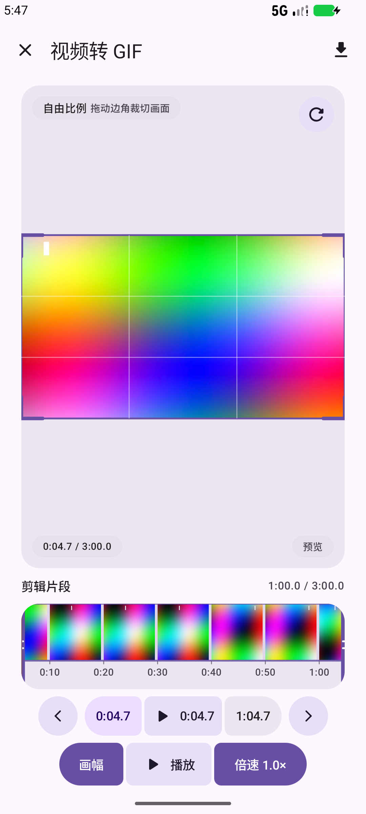
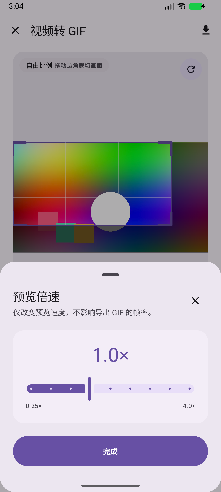
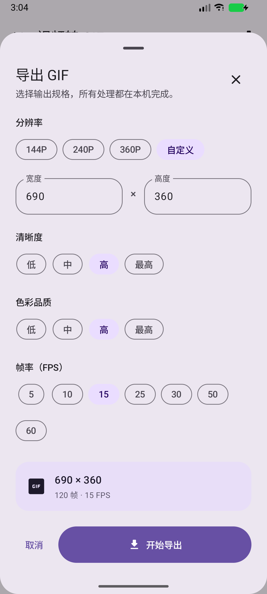
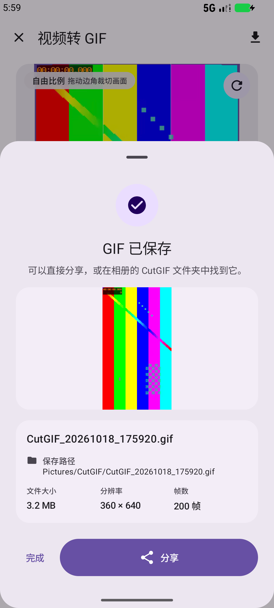
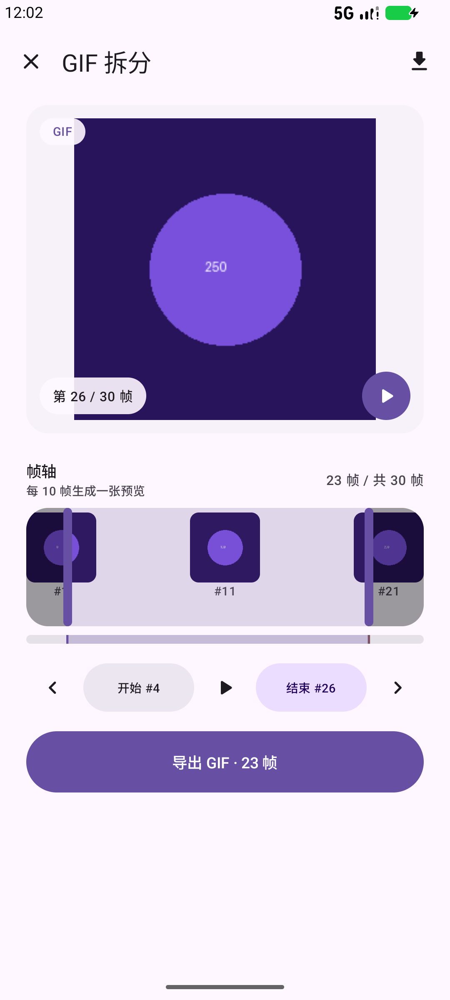

**简体中文** | [English](README.en.md)

# CutGIF

> **AI 生成内容免责声明**
>
> 本项目的代码、文档、截图和测试内容由 AI 辅助生成或大幅修改，可能包含错误、遗漏、不准确或不安全的实现。请在用于生产环境、分发或商业用途前自行审查、测试和验证。项目按“现状”提供，不附带任何明示或暗示的担保；因使用本项目造成的任何直接或间接损失，作者不承担责任。第三方组件和参考项目分别遵循其自身许可证。

一个使用 **Jetpack Compose + Material 3 Expressive** 构建的 Android 原生视频转 GIF 与 GIF 拆分工具。
单 Activity、Compose Navigation、ViewModel 状态提升；视频解码、裁切、调色与 GIF 编码全部在设备本地完成，不上传任何内容。

截图为中文界面。



## 功能

- **视频转 GIF**：系统 Photo Picker 选择本地视频，进入剪辑工作台。
- **可视化裁切**：拖拽四角调整裁切框；支持自由比例、1:1、16:9、9:16、4:3。
- **胶片条剪辑**：时间窗最长 60 秒；60 秒及以上按 10 秒分格，不足 60 秒的视频按 6 等分格显示完整时长。缩略图尺寸固定，视频画面按中间区域裁切。左右拖动时，缩略图、10 秒刻度和时间戳像车厢一样连续滑动，时间窗与截取区间同步移动且长度保持不变，入点 / 出点始终在视口内。拖动使用胶片条本地状态，以 60fps 跟手，每 80ms 才提交一次 ViewModel，避免整个编辑器重组。刻度文本预布局缓存，拖动时不再逐帧重新测量文字。截取区间最大 60 秒，最短 0.1 秒。
- **精确微调**：按 0.1 秒微调当前选中的入点或出点；任意指针变更都会把播放指针重置到入点。
- **预览播放**：ExoPlayer 预览，播放指针在入点 / 出点之间循环；支持 0.25×–4× 离散倍速。
- **GIF 导出**：
  - 144P / 240P / 360P / 自定义分辨率
  - 低 / 中 / 高 / 最高 清晰度与色彩品质
  - 5 / 10 / 15 / 25 / 30 / 50 / 60 FPS
  - 实时进度、导出取消、分享与保存路径
  - 导出结果内嵌循环动画预览
- 导出文件保存到系统相册 `Pictures/CutGIF`（Android 10+，通过 MediaStore）。
- **GIF 拆分 / 编辑**：选择 GIF 后进入帧轴工作台。胶片条每 10 帧取一张预览，可拖动开始 / 结束帧、逐帧微调，并按选中区间预览播放。导出选项改为色彩品质（低 / 中 / 高 / 最高）与输出尺寸（原始 / 75% / 50% / 25%）；导出的仍然是循环 GIF，保留原始帧延迟，保存到 `Pictures/CutGIF/CutGIF_时间戳.gif`，可直接分享。透明区域会以白色填充。

| 剪辑工作台 | 画幅选择 |
| --- | --- |
|  |  |

60 秒窗口连续滑动：拖动后，车厢、10 秒刻度和时间戳一起平移，截取区间长度仍为 `1:00`，两端指针仍然可见：



| 预览倍速 | 导出配置 |
| --- | --- |
|  |  |



GIF 拆分 / 编辑工作台：帧轴每 10 帧一张预览，开始 / 结束帧可拖拽，导出面板提供色彩品质和输出尺寸，导出结果仍然是 GIF：



## 设计规范

- **Light-only Material 3 配色**：严格使用需求中给定的 primary / secondary / tertiary / surface / outline / error 等角色色值。业务组件全部通过 `MaterialTheme.colorScheme` 取色。
- **造型**：
  - 按钮默认胶囊形（高度的一半）
  - 卡片 / 预览 / 胶片条圆角 20dp
  - BottomSheet、导出面板、确认对话框圆角 28dp
  - Connected Button Group 间距 3dp，相连内侧圆角 8dp，外侧保持胶囊形
- **字体**：系统 Roboto，使用 Material 3 TypeScale（`titleLarge`、`titleMedium`、`labelLarge`、`bodyMedium` 等）。
- **动效**：页面右侧弹性滑入（spring），返回时滑出；按钮按压缩放 + Material ripple。
- **尺寸**：集中在 `CutGifDimens` 与 `CutGifShape` 中，遵循 8dp 栅格；规范明确要求的 44dp 微调按钮、3dp 相连间距单独建 token。

## 工程结构

```
app/src/main/java/com/fgxyx/cutgif/
├── MainActivity.kt               # 单 Activity + edge-to-edge
├── data/
│   ├── VideoFrames.kt            # 元数据、缩略图、方向处理
│   ├── GifExportRepository.kt    # 导出、MediaStore、分享
│   ├── FfmpegGifExporter.kt      # FFmpeg 管线、AV1/libdav1d、进度
│   ├── GifFrameCounter.kt        # GIF 帧数校验
│   ├── GifMetadata.kt            # GIF 尺寸、帧数、帧延迟解析
│   ├── GifFrameRenderer.kt       # 按帧号渲染 GIF 画面
│   ├── GifSplitRepository.kt     # GIF 重编码、MediaStore、分享
│   ├── ExportModels.kt           # 导出参数与结果
│   └── CropRectN.kt              # 归一化裁切框
├── gif/
│   ├── GifEncoder.kt             # GIF89a / LZW / 帧延迟（兼容回退）
│   └── ColorQuantizer.kt         # Median Cut + 有序抖动 + 缓存
├── ui/
│   ├── CutGifApp.kt              # Compose Navigation 与页面转场
│   ├── home/HomeScreen.kt
│   ├── editor/                   # 视频工作台、胶片条、裁切、BottomSheet、ViewModel
│   ├── split/                    # GIF 拆分帧轴、导出面板、ViewModel
│   ├── components/               # Connected Group、按压缩放
│   ├── theme/                    # 色板、Shape、Dimens
│   └── util/                     # 时间轴格式化
app/src/test/java/com/fgxyx/cutgif/gif/GifEncoderTest.kt
app/src/androidTest/java/com/fgxyx/cutgif/HomeScreenTest.kt
```

## 构建与运行

当前版本：**1.0.0**（主页右上角显示 `v1.0.0`）。

要求：

- JDK 17+
- Android SDK Platform 37 / Build Tools 36
- 设备或模拟器 API 26+

```bash
./gradlew :app:assembleDebug
./gradlew :app:testDebugUnitTest
```

APK 输出：

```
app/build/outputs/apk/debug/app-debug.apk
```

安装：

```bash
adb install -r app/build/outputs/apk/debug/app-debug.apk
```

## 实现说明

- **播放器**：ExoPlayer + SurfaceView，零音量预览。打开 BottomSheet 或拖动裁切时会暂停播放，减少弹层动画时的合成压力。模拟器检测到 `ranchu` 硬件时自动优先软件解码器，避免部分模拟器 H.264 硬解异常；真实设备使用默认硬解并开启解码回退。
- **裁切**：裁切框以归一化坐标保存在 ViewModel 中；导出时按实际视频像素裁切后再缩放，固定比例在像素空间保持精确。
- **GIF 编码（主路径）**：使用 FFmpegKit **video** 维护版（含 libdav1d / libvpx 软件解码）。AV1 源会显式使用 `-c:v libdav1d`，不再依赖设备的硬件 AV1 解码器；随后用 `fps=目标帧率` 精确重采样、裁切 / Lanczos 缩放，再通过 `palettegen/paletteuse` 编码 GIF。
- **AV1 兼容**：部分 Android 设备没有硬件 AV1 解码器。FFmpegKit min 版本只有 MediaCodec，会在 AV1 上失败；本项目改用 video 版本并强制 libdav1d 软件解码。
- **导出加速**：
  - 不再逐帧 `MediaMetadataRetriever` 取帧；整段视频只解码一遍，由 FFmpeg 的 `fps` 滤镜完成 30→25 / 60→25 等重采样。
  - 调色板改为在 Android 端从 3 个代表帧生成 256 像素 PNG，不再单独跑一遍 FFmpeg 解码；FFmpeg 只负责主编码。这避免了 AV1 源在 palette 阶段卡住、进度一直不动。
  - 若本地调色板失败，才回退到 FFmpeg palette。
  - 进度会先报告视频拷贝、调色板、FFmpeg 编码阶段；FFmpeg 长时间不回调统计时用节流心跳推进，避免界面一直停在 0%。
  - 进度、取消、临时文件清理和 MediaStore 保存均由导出协程统一管理。
  - 若 FFmpeg 在个别设备上初始化失败，会回退到旧的 MediaMetadataRetriever + Kotlin 编码器，并对异常帧数元数据禁用索引批处理。
- **帧率精度**：FFmpeg `fps` 滤镜按目标帧率输出；GIF 帧延迟以 1/100 秒为单位，25 FPS 写 4cs，30 FPS 写 3cs。预览倍速与导出帧率互不影响。
- **GIF 拆分 / 编辑**：`GifMetadataReader` 解析画布尺寸、总帧数与每帧延迟；`GifFrameRenderer` 用 GIF 帧起始时间定位画面。帧轴每 10 帧加载一张缩略图，开始 / 结束帧按帧号映射到整条帧轴，支持拖拽和单帧微调。导出时把选中帧重新编码为循环 GIF，保留原始帧延迟；色彩品质控制调色板大小和抖动，透明区域以白色填充。Q+ 通过 MediaStore 写入 `Pictures/CutGIF/CutGIF_时间戳.gif`，旧系统写入应用外部图片目录并通过 FileProvider 分享。
- **状态提升**：播放状态、入点 / 出点、当前指针、画幅、倍速、导出配置和导出进度均由 `EditorViewModel` 管理；GIF 拆分的帧区间、当前帧、色彩品质和输出尺寸由 `GifSplitViewModel` 管理。
- **无网络权限**：所有处理都在本地完成。
- **大文件提示**：长片段 / 高帧率 GIF 本身会很大，导出面板会在预计超过 600 帧时提示降低帧率或缩短区间。

## 测试

```bash
./gradlew :app:testDebugUnitTest
./gradlew :app:connectedDebugAndroidTest
```

包含：

- 全局调色板 GIF 的可读性、帧数、尺寸与结束符校验
- 量化器输出颜色数上限与索引合法性校验
- 主页入口与“功能即将上线”Snackbar 的 Compose UI 仪器化测试（`app.androidTest`）

> Android Studio 中运行主应用请选择 **app** 配置；运行仪器化测试请选择 **app.androidTest** 配置。若 IDE 仍提示无法获取包，请先执行 `File → Sync Project with Gradle Files`，再重新运行对应配置。

## 故障排查

从 1.4.0 开始，导出过程会输出 `CutGifExport` 日志。最重要的一段是：

```text
EXPORT_START version=... sdk=... abis=... ffmpeg=...
ffmpeg engine=two-pass command=...
...
EXPORT_DONE engine=ffmpeg frames=... size=... elapsedMs=...
```

如果 FFmpeg 失败，会出现：

```text
FFMPEG_FALLBACK engine=legacy reason=<异常类>:<原因> elapsedMs=...
```

成功页此时会显示“兼容导出（较慢）”提示——只要看到这条提示，就说明 FFmpeg 没有跑起来，慢是回退路径导致的。请把 `EXPORT_START` 到 `FFMPEG_FALLBACK`（含堆栈）完整发出来。

```bash
adb logcat -c
# 在应用中复现一次导出
adb logcat -d -s CutGifExport:V > cutgif-export.log
```

如果导出帧数异常，还可以提供：

- 原始视频文件
- `Pictures/CutGIF` 下导出的 GIF
- 导出时选择的分辨率、清晰度、色彩品质、FPS
- 胶片条的录屏或截图

## 第三方组件

完整清单、版权声明和 LGPL 分发注意事项见 [THIRD_PARTY_NOTICES.md](THIRD_PARTY_NOTICES.md)。

- [FFmpegKit maintained](https://github.com/ffmpegkit-maintained/ffmpeg)（LGPL-3.0，`ffmpeg-kit-video` 变体）：FFmpeg 原生解码（含 libdav1d AV1 软件解码）、fps / crop / scale / palette 滤镜和 GIF 编码。
- [FFmpeg](https://ffmpeg.org/)（LGPL-2.1+）：多媒体框架。
- libdav1d（BSD-2-Clause）与 libvpx（BSD-3-Clause）：视频编解码。
- smart-exception-java（BSD-3-Clause）：FFmpegKit 异常信息依赖。
- AndroidX / Jetpack Compose / Media3 / Kotlin（Apache-2.0）。

GIF 导出的思路参考了 [CuteGIF](https://github.com/tasy5kg/CuteGIF) 使用 FFmpeg `fps` + `palettegen` / `paletteuse` 的方案；本项目独立实现，并使用 LGPL 版本的 FFmpegKit。

## 开源协议

CutGIF 应用代码采用 [Apache License 2.0](LICENSE)，Copyright 2026 FGXYX。

第三方组件、FFmpeg/FFmpegKit 和编解码库分别遵循其自身许可证；完整版权声明、许可证文本和分发注意事项见 [THIRD_PARTY_NOTICES.md](THIRD_PARTY_NOTICES.md) 与 [`licenses/`](licenses/)。对外分发包含 FFmpeg 的 APK 前，请确认 LGPL 的源码提供、许可证保留和可替换/重链接要求。

## 说明

- 需求指定的 Material 3 色板已完整映射到 `ui/theme/Color.kt`，业务组件没有颜色字面量。
- 页面转场、Connected Button Group、按压缩放等交互均为 Compose 原生实现。
- GitHub 入口：https://github.com/FGXYX
- 开发与自动化约定见 [AGENT.md](AGENT.md)。

---

**语言 / Language：** [简体中文](README.md) | [English](README.en.md)
